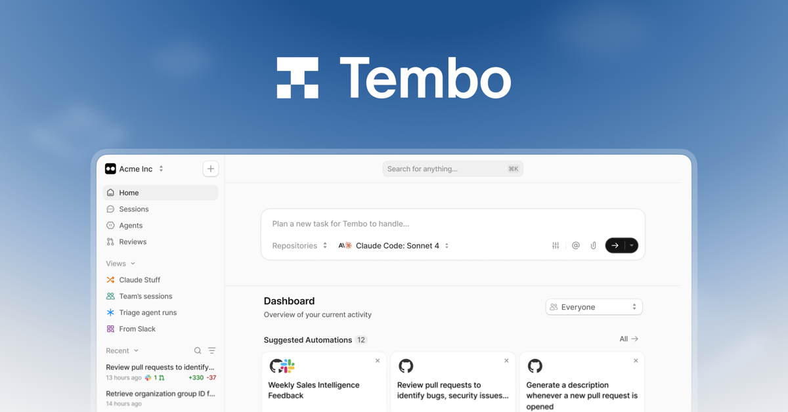

<a href="https://www.tembo.io/?utm_source=github&utm_medium=org-profile&utm_campaign=tembo">
  <picture>
    <source media="(prefers-color-scheme: dark)" srcset="./assets/logo-light.svg">
    <source media="(prefers-color-scheme: light)" srcset="./assets/logo-dark.svg">
    
  </picture>
</a>

<h3>Run AI coding agents in complete, shareable software environments.</h3>

Turn issues, alerts, and ideas into reviewed pull requests — with Claude Code, Codex, Cursor, Amp, and more.

 

&nbsp;

&nbsp;

  

 

## 👋 Welcome to Tembo

Tembo is the automation layer for engineering teams. Hand off issues, bugs, and alerts, and Tembo agents work in full development environments to turn them into pull requests your team can review and merge.

<table>
  <tr>
    <td width="50%" valign="top">
      <h4>🤖 Autonomous code changes</h4>
      Hand off issues, bugs, and alerts. Tembo agents work across your repos and open pull requests ready for review.
    </td>
    <td width="50%" valign="top">
      <h4>🖥️ Full environments, not just a chat</h4>
      Every session gets a terminal, source code, and a live computer, so agents can run, test, and visually verify their work.
    </td>
  </tr>
  <tr>
    <td width="50%" valign="top">
      <h4>🔗 Shareable previews</h4>
      Spin up public preview links for frontends, APIs, and services so your whole team can review the real product.
    </td>
    <td width="50%" valign="top">
      <h4>🧩 Bring your agents & tools</h4>
      Claude Code, Codex, Cursor, Amp, and more, with MCP tool access plus integrations for GitHub, GitLab, Linear, Jira, and Slack.
    </td>
  </tr>
  <tr>
    <td width="50%" valign="top">
      <h4>🔒 Enterprise-ready</h4>
      SSO, RBAC, SOC 2 Type I, and self-hosted / VPC deployment options.
    </td>
    <td width="50%" valign="top">
      <h4>⚡ Built for developers</h4>
      A REST API and <a href="https://www.npmjs.com/package/@tembo-io/sdk">TypeScript SDK</a> let you trigger agents from anywhere.
    </td>
  </tr>
</table>

 

### Ready to put agents to work?

<a href="https://www.tembo.io/?utm_source=github&utm_medium=org-profile&utm_campaign=tembo">Website</a> · <a href="https://docs.tembo.io">Docs</a> · <a href="https://docs.tembo.io/api">API</a> · <a href="https://www.tembo.io/developers?utm_source=github&utm_medium=org-profile&utm_campaign=tembo">Developers</a> · <a href="https://x.com/tembo">X</a> · <a href="https://www.linkedin.com/company/tembo-inc">LinkedIn</a>

